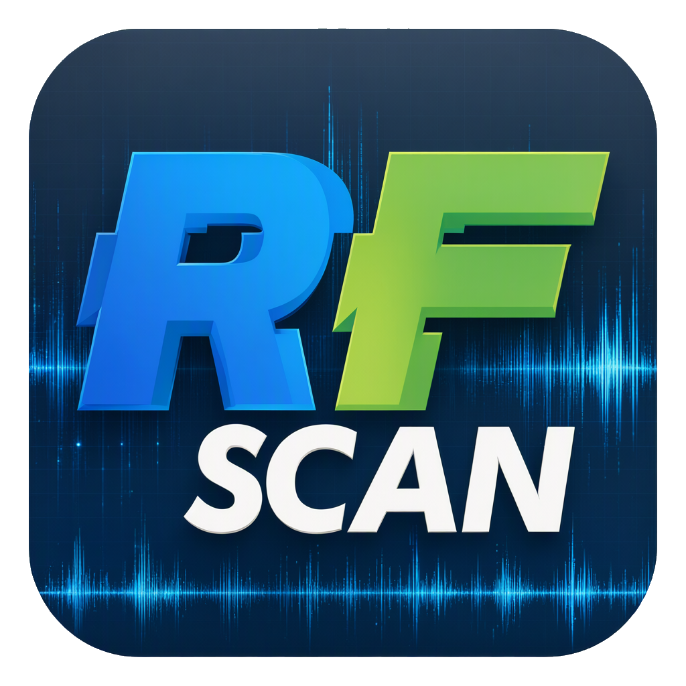
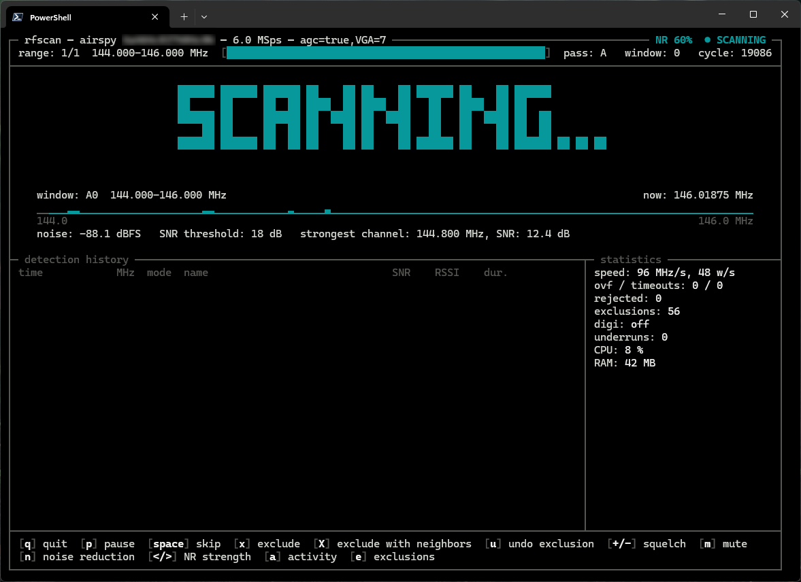

<p align="center"></p>

<p align="center"><a href="https://b4sh.github.io/rfscan/">Project page</a> · <a href="../../releases/latest">Download</a> · <a href="DOC.md">Documentation</a></p>

<p align="center">
  <a href="../../releases/latest"></a>
  <br>
  
  
  <a href="LICENSE"></a>
  <a href="../../releases"></a>
</p>

# rfscan

A fast radio scanner for SDR receivers, running in the terminal. rfscan sweeps frequency ranges or a list of channels, stops on a signal, demodulates it (AM or narrowband FM) and plays it, then goes on scanning when the transmission ends. Digital voice (DMR, P25, D-STAR, YSF, NXDN and others) is played through [DSD-FME](https://github.com/lwvmobile/dsd-fme). A built-in web page lets you watch, hear and control the scanner from a phone.

> [!IMPORTANT]
> **Set the settle time for your receiver before the first scan.** After every retune a receiver keeps delivering samples of the previous frequency for a while, from a few to over a hundred milliseconds. If `--settle` is shorter than that, rfscan sees signals in the wrong places and scanning does not work properly. The default of 20 ms fits an Airspy, not an RTL-SDR: an RTL-SDR needs about 63 ms with smaller stream buffers (`--stream-args "bufflen=16384,buffers=64"`) and over 110 ms without them. `rfscan --calibrate` measures the right value for your receiver. An RTL-SDR also needs `--sample-rate 2.4M`: higher rates are unstable and can make the dongle stop responding. See [Receiver setup](https://github.com/b4sh/rfscan/blob/main/DOC.md#receiver-setup).

It works with any receiver supported by [SoapySDR](https://github.com/pothosware/SoapySDR) and is written in Rust.

## How it works

- **Wide windows instead of single channels.** One tuner setting covers many channels at once: about 80% of the sample rate, e.g. 4.8 MHz at 6 MSps. An FFT measures the power of every channel in the window, so a whole band is checked with a handful of retunes. On an Airspy Mini that is about 220 MHz per second.
- **Detection by signal-to-noise ratio.** The noise floor is measured in every window, and a channel that rises a set number of dB above it (`--squelch-snr`) stops the scanner. A hit is first confirmed at a different tuner frequency, so receiver artifacts (images, spurs) do not stop it, and the DC spike in the middle of the band never falls on a channel.
- **Listening.** On a stop the channel is mixed down digitally and demodulated; the audio goes through a 300-3000 Hz filter, an AGC (stations sound equally loud), speech noise reduction (RNNoise) and a limiter. After the signal disappears the scanner waits a moment (`--pause`) and goes on.
- **Knowledge of your band.** A channel file gives names and modes to frequencies, an exclusion list skips interference and unwanted channels (one key in the TUI), and an activity log counts how long each frequency was active.
- **Three ways to use it.** A text interface (TUI), a plain console mode for logs and scripts (`--headless`), and a web GUI for a phone or a browser (`--web-gui`).



## Tested receivers

| Receiver | Settings that worked | Speed, Windows 11 PC | Speed, Raspberry Pi 4 |
|---|---|---|---|
| Airspy Mini | `--gain "agc=true,VGA=7" --settle 20` | about 220 MHz/s at 6 MSps | about 225 MHz/s at 6 MSps |
| RTL-SDR (R828D) | `--sample-rate 2.4M --gain "TUNER=28" --stream-args "bufflen=16384,buffers=64" --settle 63` | about 20 MHz/s at 2.4 MSps | about 28 MHz/s at 2.4 MSps |
| SDRplay RSP1A (API 3.15) | `--sample-rate 6M --gain "IFGR=43,RFGR=4" --settle 63` | about 90 MHz/s (measured at 8 MSps) | about 67 MHz/s at 6 MSps |

Tested on Windows 11 and on a Raspberry Pi 4 (4 GB, Debian 13 64-bit). On the Raspberry Pi the scan is as fast as on a PC: the speed is limited by the receiver (retune and settle time), not by the computer. Other SoapySDR receivers should work without code changes: rfscan reads all limits (frequencies, sample rates, gain stages, sample format) from the device. Reports about other receivers are welcome.

## Quick start

1. **Get rfscan.**
   - **Windows:** download the zip from [Releases](../../releases) and unpack it. It contains `rfscan.exe` with SoapySDR and the receiver drivers, so nothing else (PothosSDR) is needed.
   - **Or build it from source** (Windows, Linux): install SoapySDR with the module of your receiver (on Windows [PothosSDR](https://downloads.myriadrf.org/builds/PothosSDR/) added to `PATH`, on Linux the system packages) and [Rust](https://rustup.rs/), then `cargo build --release`; the program is `target/release/rfscan` (on Linux `packaging/linux/install.sh` builds it and installs it to `/usr/local/bin`). Details, and two PothosSDR libraries that should be replaced (RTL-SDR, SDRplay), are in [DOC.md](DOC.md#installation).
2. **Install the USB driver** of your receiver: on Windows the WinUSB driver through [Zadig](https://zadig.akeo.ie/), e.g. for an RTL-SDR. An Airspy needs no driver installation (Windows sets it up by itself), an SDRplay needs the SDRplay API service instead.
3. **Check that the receiver is seen**, with its gain stages and settings:
   ```
   rfscan --list-devices
   ```
4. **Set the gain and the settle time: they are the basis of good results**, and rfscan cannot guess them.
   - **Gain** (`--gain`): too little hides weak signals, too much overloads the receiver with false signals, and automatic gain is often a poor choice for scanning. Find good values for your antenna and place in SDR# or SDR++ and give them as gain stages, e.g. `--gain "LNA=9,MIX=10,VGA=7"` on an Airspy or `--gain "TUNER=28"` on an RTL-SDR.
   - **Settle time** (`--settle`): after a retune the receiver still delivers samples of the previous frequency for a while. Too short a settle shows "ghosts" of signals in wrong places and loses samples. Measure it on your receiver:
     ```
     rfscan --calibrate --gain "..." --scan-range 144M-146M
     ```
     The calibration needs a strong constant signal in the given range (a beacon, a repeater, or with the antenna disconnected a carrier of the receiver itself) and offers to save the result.
   - **Sample rate** (`--sample-rate`): the highest one is not always the best; take the highest one that runs without overflows.
5. **Save your settings** so you do not type them every time:
   ```
   rfscan --gen-conf
   ```
   writes `~/.config/rfscan/rfscan.conf` with all options commented out; uncomment `gain`, `settle`, `sample-rate` and whatever else you need.
6. **Scan:**
   ```
   rfscan --scan-range 144M-146M                 # 2 m band, NFM, 12.5 kHz channels
   rfscan --scan-range 118M-137M:am              # airband, AM, 8.33 kHz channels
   rfscan --scan-range 144M-146M --scan-range 430M-440M:12.5k
   rfscan --scan-channels 145.5M,118.1M:am       # single channels
   rfscan --web-gui 0.0.0.0:8080                 # plus a web page for a phone in the home network
   ```
   In the TUI: `q` quit, `space` skip, `x` exclude the frequency, `p` pause, `a` activity, `+`/`-` squelch.

`rfscan -h` lists the most used options, `rfscan --help` all of them. The full description is in [DOC.md](DOC.md).

## License

Copyright (C) 2026 SQ1KW Chris

rfscan is free software: you can redistribute it and/or modify it under the terms of the GNU Affero General Public License as published by the Free Software Foundation, either version 3 of the License, or (at your option) any later version.

rfscan is distributed in the hope that it will be useful, but WITHOUT ANY WARRANTY; without even the implied warranty of MERCHANTABILITY or FITNESS FOR A PARTICULAR PURPOSE. See the GNU Affero General Public License for more details.

You should have received a copy of the GNU Affero General Public License along with rfscan (the `LICENSE` file). If not, see <https://www.gnu.org/licenses/>.

The AGPL keeps rfscan open: anyone who distributes it, modified or not, or lets others use a modified version over a network (e.g. through the web GUI), must make the complete source code available under the same license.

Third-party Rust crates used by rfscan are under their own permissive licenses (MIT, Apache-2.0, BSD, Zlib, BSL-1.0, MPL-2.0 and similar), all compatible with the AGPL. SoapySDR, the receiver drivers and DSD-FME are separate programs and are not part of rfscan.
